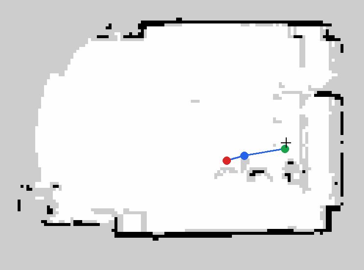

# TurtleBot3 Burger + RPLIDAR A1：Nav2 導航與路線錄製紀錄（2026-10-28）

環境：Ubuntu 24.04、ROS 2 Jazzy（筆電與機器人相同）、`ROS_DOMAIN_ID=30`、`TURTLEBOT3_MODEL=burger`

結果：
- 已用 Cartographer 建好的地圖（`maps/map.yaml`）在實機上啟動 Nav2，並可以單點導航
- 寫了兩支腳本：用 `teleop_keyboard` 邊開邊錄路線（`record_route.py`），再讓 Nav2 照路線跑（`follow_route.py`）
- 機器人能自己開回路線起點，但沿路線行駛時 AMCL 定位跳動，第一次完整測試**失敗**（詳見[問題排解](#問題排解)）



## 檔案說明
- `README.md`：架構、啟動步驟與問題排解（本文件）
- `conversation.md`：對話紀錄（摘要），包括系統檢查、Nav2 除錯與路線錄製
- `launch/tb3_rplidar.launch.py`：機器人端 bringup，用 RPLIDAR A1M8 取代原廠 LDS（放在機器人的 `~/`）
- `scripts/record_route.py`：錄製路線，從 TF `map → base_footprint` 每 0.7 m 或轉 45° 記一點
- `scripts/follow_route.py`：讓 Nav2 照路線行駛，先開到起點再連續通過其餘點
- `maps/map.pgm`、`maps/map.yaml`：Cartographer 建的地圖（124 × 92 格，0.05 m/格，約 6.2 × 4.6 m）
- `routes/route.yaml`：錄好的範例路線（3 點、約 1 m 直線）
- `images/map_route.png`：地圖與路線預覽

## 硬體架構
| | 筆電 | 機器人 |
|---|---|---|
| 硬體 | x86 筆電 | TurtleBot3 Burger（Raspberry Pi 4B + OpenCR） |
| 接的裝置 | RPLIDAR A1（CP2102，`/dev/ttyUSB0`） | OpenCR（`/dev/ttyACM0`） |
| 執行的節點 | `rplidar_node`、Nav2、RViz、路線腳本 | `turtlebot3_ros`、`robot_state_publisher` |

注意：光達接在**筆電**上，不是機器人上，但 `/scan` 的 frame 是機器人的 `base_scan`。所以光達必須固定在機器人上、跟車子一起移動，否則定位會錯。

## 安裝
```bash
sudo apt install ros-jazzy-turtlebot3 ros-jazzy-navigation2 ros-jazzy-nav2-bringup \
                 ros-jazzy-rplidar-ros ros-jazzy-cartographer-ros
echo 'export ROS_DOMAIN_ID=30' >> ~/.bashrc
echo 'export TURTLEBOT3_MODEL=burger' >> ~/.bashrc
sudo usermod -aG dialout $USER       # 讀 /dev/ttyUSB0 要用，需登出再登入
```

## 啟動步驟
### 1. 機器人 bringup（SSH 進機器人）
```bash
ssh kai@<機器人IP>
ros2 launch ~/tb3_rplidar.launch.py use_lidar:=false   # 光達在筆電上，所以這裡關掉
```

### 2. 筆電：光達
```bash
ros2 run rplidar_ros rplidar_composition --ros-args \
  -p serial_port:=/dev/ttyUSB0 -p serial_baudrate:=115200 \
  -p frame_id:=base_scan -p angle_compensate:=true
ros2 topic hz /scan                  # 應該約 7.8 Hz
```

### 3. 筆電：Nav2 + RViz
```bash
cd turtlebot3-rplidar-nav2         # 本 repo 的根目錄，以下指令都在這裡執行
ros2 launch turtlebot3_navigation2 navigation2.launch.py use_sim_time:=false map:=$PWD/maps/map.yaml
```
**啟動後 60 秒內**必須在 RViz 用 **2D Pose Estimate** 設好起始位置，否則會失敗，原因見[問題 1](#1-啟動後-60-秒內沒設起始位置導航節點啟動失敗)。

### 4. 錄製路線
```bash
python3 scripts/record_route.py routes/route.yaml     # 終端機 A
ros2 run turtlebot3_teleop teleop_keyboard            # 終端機 B，開完整條路線
# 回到終端機 A 按 Ctrl+C 存檔
```

### 5. 照路線行駛
```bash
python3 scripts/follow_route.py routes/route.yaml               # 連續通過（NavigateThroughPoses）
python3 scripts/follow_route.py routes/route.yaml --stop        # 每點停一下（FollowWaypoints）
python3 scripts/follow_route.py routes/route.yaml --loops 3     # 跑 3 圈
```

## 問題排解
### 1. 啟動後 60 秒內沒設起始位置，導航節點啟動失敗
`global_costmap` 會等 `map → base_link` 的 TF，最多 60 秒，逾時後 `planner_server` 會啟動失敗：
```
Failed to activate global_costmap because transform from base_link to map did not become available before timeout
```
解法有兩種：
- 在 60 秒內設好起始位置。
- 已知起始位置時，等 AMCL active 後直接送 `/initialpose`：
```bash
ros2 topic pub --times 3 --rate 2 /initialpose geometry_msgs/msg/PoseWithCovarianceStamped \
  "{header: {frame_id: map}, pose: {pose: {position: {x: 0.0, y: 0.0}, orientation: {w: 1.0}}, \
   covariance: [0.25,0,0,0,0,0, 0,0.25,0,0,0,0, 0,0,0,0,0,0, 0,0,0,0,0,0, 0,0,0,0,0,0, 0,0,0,0,0,0.0685]}}"
```
也可以分兩段啟動：先只啟動定位，設好位置後再啟動導航（`command: 0` = STARTUP）：
```bash
ros2 service call /lifecycle_manager_localization/manage_nodes nav2_msgs/srv/ManageLifecycleNodes "{command: 0}"
ros2 service call /lifecycle_manager_navigation/manage_nodes   nav2_msgs/srv/ManageLifecycleNodes "{command: 0}"
```

### 2. RViz 按 Reset 之後再 Startup，Nav2 當機
`nav2-bt-navigator 1.3.13` 在 Reset（cleanup）之後重新 configure 時，`nav2_container` 會 Segmentation Fault，所有 Nav2 節點都會不見：
```
Magick: abort due to signal 11 (SIGSEGV) "Segmentation Fault"...
[ERROR] [component_container_isolated-1]: process has died
```
這個問題重現了兩次。
- 要停車用 **Cancel**，不要按 Reset。
- 按 **Pause** 之後用 **Resume**（`command: 2`）恢復沒有問題，因為只會重新 activate，不會重新 configure。
- 真的需要重置時，直接把整個 launch 關掉重開。

### 3. `burger.yaml` 的多點導航行為樹設錯
`turtlebot3_navigation2 2.3.6` 的 `param/burger.yaml` 把 `default_nav_through_poses_bt_xml` 設成 `navigate_to_pose_w_replanning_and_recovery.xml`。這棵樹不會讀多點目標，planner 會收到空的 goal：
```
[transformPoseInTargetFrame]: Failed to transform from  to map
GridBased plugin failed to plan from (0.21, 0.15) to (0.00, 0.00)
```
`follow_route.py` 會在送出目標時，直接指定 `navigate_through_poses_w_replanning_and_recovery.xml`，所以不用改系統檔案。

### 4. 路線一送出就「成功」，但機器人沒有動
有兩個原因：
- `NavigateThroughPoses` 的行為樹會用 `RemovePassedGoals radius="0.7"`，把 0.7 m 內的點當作已經經過並移除，而終點容許誤差是 `xy_goal_tolerance: 0.25`。路線太短時，所有點一開始就被判定到達了。
- 控制器只檢查**路徑終點**。機器人剛好停在終點時（剛錄完就是這樣），送出後會立刻回報成功。

解法：
- 錄製間隔改成 0.7 m。
- `follow_route.py` 會先 `goToPose` 開到起點，再對其餘的點送 `goThroughPoses`。

### 5. AMCL 定位不穩（未解決）
路線測試時，剩餘距離在 0.02 m 和 1.6 m 之間跳動。Nav2 一度認為機器人在 (-0.31, -1.84)，已經靠近地圖下緣的牆，規劃器規劃不出路徑：
```
GridBased plugin failed to plan from (-0.31, -1.84) to (-1.01, -0.31): "Failed to create plan with tolerance of: 0.500000"
Collision Ahead - Exiting Spin
```
可能的原因：
- 光達接在筆電上，跟車體的相對位置不固定。
- RPLIDAR 的 0° 方向和 TurtleBot3 URDF 的 `base_scan` 不一致。
- 地圖小，左半邊幾乎沒有牆面特徵（見上圖）。

## 待辦
- [ ] 確認光達固定方式；用 teleop 原地轉一圈，看雷射點是否一直貼著地圖牆壁
- [ ] 如果光達方向不對，在 `base_scan` 的 TF 或驅動參數（`inverted`、static transform）修正
- [ ] 把光達移到機器人上（`use_lidar:=true`），不再依賴筆電
- [ ] 複製一份 `burger.yaml` 修正 through-poses 行為樹，並視需要調整 AMCL 參數
- [ ] 重新錄一條較長、有轉彎的路線，完成完整的路線測試
